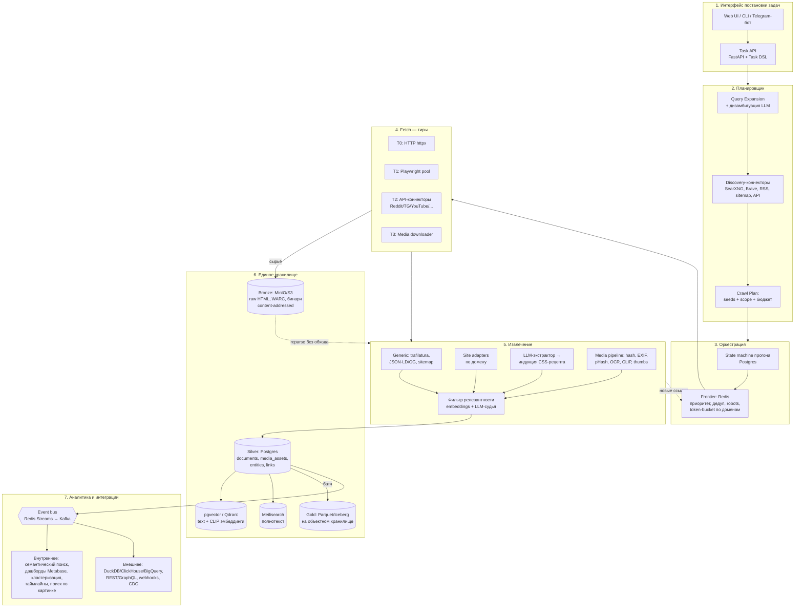

# Универсальная система парсинга (Universal Harvester)

> Архитектурный документ v1. Допущения: self-hosted (datadom), Python 3.12, Docker Compose на старте,
> Kubernetes/несколько узлов — как путь роста. Один оператор + возможность роста до команды.

---

## 1. Идея и ключевые принципы

Пользователь формулирует **тему/объект** (пример: `Sol Lemon`). Система сама:
находит источники → обходит их → извлекает разнородный контент (текст, изображения, видео, файлы,
структурированные данные) → кладёт всё в **единое хранилище с общей моделью данных** → отдаёт наружу
для аналитики.

Пять принципов, из которых выводится вся остальная конструкция:

1. **Разделение «добыть» и «понять».** Краулер сохраняет сырьё (raw HTML/бинарь) в неизменяемом виде;
   парсинг — отдельный шаг поверх архива. Изменили экстрактор → перепарсили без повторного обхода сайта.
   Это главное решение: оно даёт воспроизводимость, дешёвые эксперименты и защиту от «сайт лёг / забанил».
2. **Единая модель Item, разнородность — в деталях.** Все находки нормализуются в две сущности:
   `document` (текстово-структурная) и `media_asset` (бинарь). Разница между постом в Telegram,
   товаром на маркетплейсе и фото — в `kind` + `payload jsonb`, а не в отдельных таблицах на каждый источник.
3. **Плагины вместо форков.** Источник = плагин с контрактом `discover / fetch / extract`. Ядро не знает
   про конкретные сайты.
4. **Задача — декларативная.** Task DSL (YAML/JSON) + UI как генератор этого YAML. Всё, что делает UI,
   можно сделать через API и положить в git.
5. **Аналитика подключается через шину и открытые форматы**, а не через SQL-доступ к боевой БД.
   Один и тот же поток кормит внутренние дашборды и любой внешний инструмент.

---

## 2. Схема системы



---

## 3. Модель задачи (Task DSL)

Задача — это документ. UI просто собирает его в форме; продвинутый пользователь пишет руками.

```yaml
task: sol-lemon-research
version: 1
query:
  subject: "Sol Lemon"
  intent: "кто это, где упоминается, весь визуальный контент"
  # ограничивают дизамбигуацию; заполняются пользователем ИЛИ предлагаются планировщиком
  disambiguation:
    include_hints: ["музыка", "artist", "album"]
    exclude_hints: ["cannabis strain", "лимонад"]
  languages: [ru, en]
  time_range: { from: 2015-01-01, to: null }

discovery:
  connectors: [searxng, brave, rss, reddit, youtube, telegram]
  seeds:                       # опционально: явные точки входа
    - https://sollemon.example/
  expand_queries: true         # LLM генерит варианты запросов
  max_seeds: 200

crawl:
  scope:
    follow: same_domain_plus_outlinks_depth_1
    max_depth: 3
    max_pages: 5000
    allow: ["*"]
    deny: ["*/login*", "*/cart*", "*.exe"]
  politeness:
    respect_robots: true
    delay_per_domain_ms: 1500
    max_concurrency_per_domain: 2
  render:
    mode: auto               # auto | never | always — авто-эскалация в Playwright
  budget:
    max_wall_clock: 6h
    max_llm_usd: 5.00
    max_bytes: 20GB

extract:
  want: [article_text, images, videos, structured_ld, contacts, social_profiles]
  schema:                    # пользовательская целевая схема — LLM-экстрактор её заполняет
    name: string
    role: string
    related_entities: string[]
    first_seen: date?
  media:
    download: [image, video_thumbnail]
    min_image_px: 200x200
    ocr: true
    caption: true            # CLIP/VLM-подпись для поиска по смыслу

quality:
  relevance_threshold: 0.62
  dedup: { url: canonical, content: simhash, image: phash }

schedule:
  mode: once                 # once | cron
  cron: null                 # "0 */6 * * *" для мониторинга темы

output:
  emit_to_bus: true
  export: [parquet]          # добавляется в Gold-слой
```

**Жизненный цикл:** `draft → planning → awaiting_disambiguation? → running → (paused) → completed | failed`.
Каждый запуск = `run` со снапшотом DSL, чтобы результаты всегда были привязаны к точной версии задачи.

---

## 4. Слой 1 — интерфейс постановки задач

| Канал | Назначение |
|---|---|
| **Web UI** (React/HTMX) | форма задачи, live-прогресс прогона, просмотр результатов, ручная разметка «релевантно/нет» |
| **REST API** (FastAPI) | `POST /tasks`, `POST /tasks/{id}/runs`, `GET /runs/{id}/events` (SSE), `GET /items?...` |
| **CLI** | `harvester run task.yaml --watch` — для скриптов и CI |
| **Telegram-бот** | постановка задачи с телефона и алерты о новых находках (у вас уже есть инфраструктура ботов) |

Важный UX-момент: **дизамбигуация**. `Sol Lemon` — это может быть музыкант, бренд, сорт растения,
никнейм. Планировщик делает дешёвый пробный обход (30–50 SERP-результатов, только заголовки+сниппеты),
кластеризует их по эмбеддингам и возвращает пользователю 2–4 варианта интерпретации с примерами ссылок.
Пользователь выбирает — и только после этого запускается полноценный дорогой обход. Без этого шага
хранилище засоряется мусором, а бюджет уходит в никуда.

---

## 5. Слой 2 — планировщик / discovery

Превращает нечёткую тему в конкретный список seed-URL и правил.

1. **Расширение запроса.** LLM генерит варианты: транслитерации, синонимы, site-ограниченные запросы
   (`"Sol Lemon" site:instagram.com`), запросы на разных языках, «сущность + роль» (`Sol Lemon interview`,
   `Sol Lemon discography`).
2. **Discovery-коннекторы** (каждый — плагин):
   - `searxng` — self-hosted метапоиск, без API-ключей, главная рабочая лошадка;
   - `brave` / `google_cse` — платные, для качества и стабильности;
   - `rss` / `sitemap` / `wellknown` — расширение найденного домена вглубь;
   - `reddit`, `youtube`, `telegram`, `hn`, `wikipedia/wikidata` — предметные API;
   - `commoncrawl_index` — исторический охват без нагрузки на чужие сайты.
3. **Скоринг seed'ов**: домен-авторитет × соответствие эмбеддингу задачи × свежесть → приоритет во фронтире.
4. **Crawl Plan** — материализованный артефакт (хранится, версионируется). Его можно посмотреть и
   отредактировать до запуска.

---

## 6. Слой 3 — оркестрация

Два уровня, и их не надо путать:

- **Уровень прогона** (медленный, часы): state machine в Postgres + воркер-супервизор. Отвечает за фазы,
  бюджеты, паузу/резюм, ретраи фаз, расписание. Начинать — на своём коде + APScheduler; при усложнении
  (десятки параллельных многодневных прогонов) мигрировать на **Temporal**. Airflow/Dagster сюда плохо
  ложатся: они про DAG'и по расписанию, а не про долгоживущие адаптивные обходы.
- **Уровень URL** (быстрый, тысячи в минуту): **Frontier в Redis**.
  - очереди приоритетов на прогон + отдельная очередь на домен;
  - `token bucket` на домен (вежливость) и глобальный лимит воркеров;
  - кэш `robots.txt` с TTL;
  - дедуп URL: канонизация (сортировка query-параметров, срез utm/fbclid, нормализация хоста) → SHA-1 →
    Redis-set / Bloom-фильтр;
  - **circuit breaker** на домен: серия 429/403/таймаутов → домен уходит в холодильник с экспоненциальным
    бэкоффом, прогон не встаёт целиком.

Воркеры — stateless Python-процессы (`arq` или Celery на Redis), масштабируются числом реплик.
Разные пулы для тиров: `fetch-light`, `fetch-render` (жирный, Playwright), `extract`, `media`, `embed`.
Это критично: один тяжёлый Playwright не должен блокировать сотню дешёвых HTTP-запросов.

---

## 7. Слой 4 — Fetch (тиры и коннекторы)

Эскалация по стоимости — берём самый дешёвый способ, который сработал:

| Тир | Инструмент | Когда |
|---|---|---|
| T0 | `httpx` (HTTP/2, async) | по умолчанию |
| T1 | Playwright pool | если T0 дал < N символов текста / признаки SPA / явно указано в DSL |
| T2 | API-коннектор | если для домена есть официальный API (дешевле, стабильнее, легальнее) |
| T3 | Media downloader | отдельная очередь: изображения, видео (yt-dlp), PDF/документы |

Обвязка: ротация UA/заголовков, пул прокси (у вас уже есть hysteria — годится как выходной узел),
сессии/куки на домен, ретраи с джиттером, hard-таймауты, лимит размера ответа.

**Всё, что скачано, немедленно уходит в Bronze** (content-addressed) — до всякого парсинга.
Формат: WARC для веб-страниц (стандарт, читается любым инструментом веб-архивирования) или просто
`blob + json-манифест`, если WARC избыточен.

**Контракт плагина** — единственное, что нужно реализовать для нового источника:

```python
class Connector(Protocol):
    name: str
    def matches(self, ref: SourceRef) -> bool: ...
    async def discover(self, task: Task) -> AsyncIterator[SourceRef]: ...
    async def fetch(self, ref: SourceRef, ctx: FetchCtx) -> RawCapture: ...
    def extract(self, raw: RawCapture, task: Task) -> Iterator[Document | MediaRef]: ...
```

---

## 8. Слой 5 — извлечение и нормализация

Каскад, снова от дешёвого к дорогому:

1. **Структурные разметки** — JSON-LD / microdata / OpenGraph / oEmbed. Бесплатно и точно; покрывает
   больше сайтов, чем принято думать (новости, товары, события, персоны).
2. **Generic-экстракторы** — `trafilatura` (основной текст + дата + автор), `readability`, `selectolax`
   для скорости, `pdfplumber`/`unstructured` для документов.
3. **Site adapters** — плагины по домену, когда generic врёт.
4. **LLM-экстрактор** — для произвольной пользовательской схемы (`extract.schema` в DSL). Ключевой приём
   экономии: LLM вызывается **не на каждую страницу, а на каждый шаблон страницы**. Считаем структурный
   хеш DOM (теги+классы без текста); для нового хеша — вызов LLM, который возвращает не только данные,
   но и **CSS/XPath-рецепт**; рецепт валидируется на 2–3 других страницах того же шаблона и кэшируется.
   Дальше тысячи однотипных страниц парсятся детерминированно и бесплатно. Рецепты живут в БД,
   протухают при изменении структурного хеша.

   Второй множитель экономии — **что именно уходит в промпт**. Модели нужен каркас, а не содержимое,
   поэтому DOM проходит через `extractors/minify.py`: выкидываются нес­труктурные теги, остаются только
   атрибуты, по которым строят селекторы (`class/id/name/href/src/alt/itemprop/role`), классы вида
   `css-1a2b3c` и `sc-fzXfMB` отбрасываются (они меняются при каждой сборке — селектор на них не живёт),
   а длинные текстовые узлы заменяются плейсхолдерами `{{t0}}`, `{{t1}}` с картой обратной подстановки.
   На реальных страницах это даёт 53% экономии на статье Wikipedia и 87% на главной Guardian
   (1.35 МБ → 179 КБ). Если даже сжатая страница не влезает в окно — `split_for_llm()` режет её на части
   под токенный бюджет, сохраняя CSS-путь каждой, чтобы собрать полный селектор обратно.

5. **Пагинация как типизированная сущность** — `{type: xpath | scroll | urls | none}`. Листинги и каталоги
   не обходятся простым переходом по ссылкам: нужно уметь жать «далее» по селектору, эмулировать
   бесконечный скролл (тир T1) или разворачивать URL по шаблону. Тип определяется тем же LLM-шагом,
   что и рецепт, и кэшируется вместе с ним.

6. **Классификатор типа страницы** — `catalog | details | listing | captcha | other` — как шаг маршрутизации
   перед извлечением. Отдельно важен класс **captcha**: «нас не пустили» надо отличать от «страница пустая».
   В прогоне Фазы 0 14% фетчей упирались в антибот, и все они молча падали в общий счётчик ошибок.
7. **Media pipeline** — по каждому бинарю: sha256, MIME-sniffing, EXIF (в т.ч. геотеги/дата),
   перцептивный хеш (pHash) для дедупа и поиска похожих, превью, OCR (PaddleOCR/tesseract),
   VLM-подпись, CLIP-эмбеддинг. Подпись и OCR превращают картинку в текст → она попадает в тот же
   полнотекстовый поиск, что и статьи.
8. **Фильтр релевантности** — косинус между эмбеддингом item и эмбеддингом задачи; серая зона
   отправляется LLM-судье. Оценка **не удаляет**, а пишется в `relevance_score`: пороги можно менять
   задним числом, ничего не теряя.
9. **Извлечение сущностей и связей** — NER + линковка к Wikidata → таблицы `entities` / `links`.
   Это то, что потом даёт графовую аналитику («кто ещё упоминается рядом с Sol Lemon»).

---

## 9. Слой 6 — единое хранилище

Трёхслойная (medallion) организация: **Bronze → Silver → Gold**.

### Bronze — сырьё, MinIO / S3

```
raw/{task_id}/{run_id}/{sha256[:2]}/{sha256}          # тело ответа / бинарь
raw/{task_id}/{run_id}/manifest.jsonl                 # url, статус, заголовки, время, sha
media/{sha256[:2]}/{sha256}                           # дедуплицировано глобально по контенту
media/{sha256[:2]}/{sha256}.thumb.webp
```

Content-addressing даёт бесплатный дедуп: одна и та же картинка с 50 сайтов хранится один раз.
Bronze — иммутабельный и полный: из него в любой момент пересобирается Silver.

### Silver — нормализованная модель, Postgres

```sql
create table documents (
  id            uuid primary key,
  task_id       uuid not null references tasks(id),
  run_id        uuid not null,
  kind          text not null,        -- article|post|product|profile|comment|page|transcript|file
  source_url    text not null,
  canonical_url text,
  domain        text not null,
  connector     text not null,        -- какой плагин добыл
  lang          text,
  title         text,
  text          text,                 -- нормализованный основной текст
  author        text,
  published_at  timestamptz,
  fetched_at    timestamptz not null,
  payload       jsonb not null default '{}',  -- всё специфичное для источника + пользовательская схема
  raw_ref       text not null,        -- ключ в Bronze
  content_hash  bytea not null,
  simhash       bigint,               -- near-dup детект
  relevance     real,
  quality       real,
  labels        text[] default '{}',
  created_at    timestamptz default now()
);
create unique index on documents (task_id, content_hash);
create index on documents (task_id, published_at desc);
create index on documents using gin (payload jsonb_path_ops);
create index on documents using gin (to_tsvector('simple', coalesce(title,'') || ' ' || coalesce(text,'')));

create table media_assets (
  id           uuid primary key,
  sha256       bytea unique not null,     -- глобальный дедуп по контенту
  media_type   text not null,             -- image|video|audio|document
  mime         text,
  bytes        bigint,
  width        int, height int, duration_s real,
  blob_ref     text not null,             -- ключ в Bronze
  thumb_ref    text,
  phash        bit(64),                   -- поиск похожих изображений
  exif         jsonb,
  ocr_text     text,
  caption      text,                      -- VLM-описание
  first_seen   timestamptz default now()
);

create table document_media (
  document_id uuid references documents(id) on delete cascade,
  media_id    uuid references media_assets(id) on delete cascade,
  role        text,        -- hero|inline|gallery|attachment|thumbnail
  position    int,
  primary key (document_id, media_id, role, position)
);

create table entities (
  id uuid primary key, name text, type text, wikidata_id text, aliases text[]
);
create table document_entities (
  document_id uuid, entity_id uuid, salience real, mentions int,
  primary key (document_id, entity_id)
);
create table links (              -- граф ссылок и связей между источниками
  src_document_id uuid, dst_url text, dst_document_id uuid, rel text
);

-- Провенанс: по каждому item видно, из какого seed и какой фазы он пришёл
create table fetch_log (
  id bigserial primary key, run_id uuid, url text, status int, tier text,
  bytes int, ms int, error text, raw_ref text, at timestamptz default now()
);
```

Ключевая мысль: **текст и картинка — граждане одного класса**. `documents` и `media_assets` связаны
M:N, у обоих есть текстовое представление (`text` / `ocr_text` + `caption`) и вектор — поэтому один
запрос ищет и по статьям, и по фото.

### Индексы поверх Silver

| Индекс | Технология | Для чего |
|---|---|---|
| Векторный | **pgvector** (старт) → Qdrant (при > ~5–10 млн векторов) | семантический и кросс-модальный поиск (текстом по картинкам) |
| Полнотекстовый | **Meilisearch** (или OpenSearch, если нужны сложные агрегации) | быстрый поиск с опечатками, фасеты |
| Графовый | таблица `links` + рекурсивные CTE; Neo4j — только если граф станет основным продуктом | связи, кластеры источников |

### Gold — аналитический слой, Parquet / Iceberg на MinIO

Ночной (или потоковый) экспорт денормализованных витрин: `items_flat`, `media_flat`, `mentions_daily`.
Именно этот слой читают внешние инструменты — **без доступа к боевому Postgres**.
Iceberg берём, если нужны time travel и schema evolution; голый партиционированный Parquet
(`/gold/items/dt=2026-08-01/*.parquet`) — если хочется проще.

---

## 10. Слой 7 — аналитика и точки интеграции

Четыре точки интеграции, покрывающие оба сценария из ТЗ («развивать аналитику внутри» и
«интегрировать с внешними системами»). Они не взаимоисключающие — строятся на одном источнике правды.

1. **Event bus — главная точка.** Каждый нормализованный item публикуется в поток
   `items.normalized` (Redis Streams на старте, Kafka/Redpanda при росте) с payload'ом
   `{id, task_id, kind, url, title, hashes, media_ids, relevance, ts}`.
   Любой потребитель — внутренний дашборд, внешний ETL, ML-пайплайн, алертер, чужая система —
   подписывается, не трогая ядро. Это то решение, которое оставляет оба будущих пути открытыми.
2. **Открытые файлы.** Gold-слой в Parquet/Iceberg на S3-совместимом хранилище читается
   DuckDB, ClickHouse, Spark, Trino, pandas/polars, BigQuery (external tables) — без интеграционного кода.
3. **API.** `GET /items` с фильтрами и курсорной пагинацией, `POST /search` (гибридный:
   BM25 + вектор + фильтры), `GET /media/{id}` (пресайн-ссылка), webhooks на события задачи.
   GraphQL — если потребителям нужны выборочные графы связей.
4. **CDC.** Логическая репликация Postgres / Debezium → зеркало в аналитическом хранилище,
   когда понадобится near-real-time без обращения к боевой БД.

**Внутренняя аналитика (что имеет смысл строить прямо в системе):**

- семантический и кросс-модальный поиск по всей добыче («найди фото, похожие на это» — по pHash+CLIP);
- таймлайн упоминаний темы, всплески, источники-первоисточники (по `published_at` + графу ссылок);
- кластеризация документов (HDBSCAN по эмбеддингам) → автоматические подтемы;
- граф сущностей и совместных упоминаний;
- дашборды **Metabase / Superset** поверх read-реплики или DuckDB-над-Gold;
- операционные метрики прогона: покрытие, стоимость на item, доля мусора, здоровье доменов.

---

## 11. Сквозные аспекты

**Дедупликация — три уровня:** URL (канонизация), контент (`sha256` точный + `simhash` near-dup),
изображения (`pHash` с порогом Хэмминга). Дубли не удаляются, а склеиваются: остаётся один
`document` с массивом `source_urls` — важно для аналитики «сколько источников это перепечатали».

**Наблюдаемость.** Structured logs, OpenTelemetry-трейсы `run → seed → fetch → extract → item`,
Prometheus-метрики (RPS по доменам, доля 4xx/5xx, глубина фронтира, лаг очередей, $ на LLM),
Grafana. Отдельный экран «здоровье задачи»: сколько собрано, сколько отфильтровано, где затык.

**Стоимость.** Бюджеты в DSL — жёсткие: превышение `max_llm_usd` / `max_bytes` / `max_wall_clock`
останавливает прогон и переводит его в `paused`, а не тихо жжёт деньги. Индукция CSS-рецептов
(§8.4) — главный рычаг снижения LLM-расходов, обычно на порядок.

**Право и этика.** Соблюдение `robots.txt` и ToS по умолчанию (отключается только явным флагом
и под ответственность оператора); вежливые задержки; никакого обхода авторизации и paywall;
хранение лицензионных метаданных у медиа; отсутствие сбора персональных данных вне задачи;
процедура удаления по запросу (`DELETE /items?content_hash=` каскадом через все слои, включая Bronze);
retention-политика на задачу. Публичный доступ к системе — только за аутентификацией.

**Безопасность.** SSRF-защита во фетчере (блок private IP-диапазонов, редиректов в них),
лимит размера ответа, санитизация HTML перед рендерингом в UI, изоляция Playwright в отдельном
контейнере без доступа к внутренней сети, секреты в SOPS/Vault.

---

## 12. Стек

| Слой | Выбор | Почему именно он |
|---|---|---|
| API/UI | FastAPI + React (или HTMX) | async из коробки, SSE для live-прогресса |
| Очереди | Redis + arq | минимум движущихся частей; Redis всё равно нужен для фронтира |
| Оркестрация прогона | своя FSM на Postgres → Temporal | долгоживущие адаптивные процессы, не DAG'и |
| Обход | свои async-воркеры (+ Scrapy как один из движков) | нужны нестандартные тиры и коннекторы; Scrapy — там, где хватает его модели |
| Рендер | Playwright | лучший контроль, перехват сетевых запросов |
| Извлечение | trafilatura, selectolax, extruct, unstructured | покрывают 80% без LLM |
| LLM | Claude (Opus/Sonnet) для дизамбигуации, схем и индукции рецептов | вызовы редкие и дорогие → нужно качество, а не дешевизна |
| Эмбеддинги | multilingual-e5 (текст), CLIP/SigLIP (изображения) | локально, без внешних расходов |
| Метаданные | PostgreSQL 16 + pgvector | одна БД вместо трёх на старте |
| Блобы | MinIO (S3 API) | миграция в любое S3 без изменения кода |
| Полнотекст | Meilisearch | ставится за час, отличная релевантность из коробки |
| Аналитика | DuckDB над Parquet + Metabase | ноль инфраструктуры, полноценный SQL |
| Шина | Redis Streams → Redpanda | путь роста без переписывания потребителей |
| Деплой | Docker Compose → k8s | у вас уже есть orchestrator на datadom |

---

## 13. Структура репозитория

```
universal-harvester/
├── core/
│   ├── models/          # Task DSL, Document, MediaAsset, RawCapture (pydantic)
│   ├── frontier/        # очередь, дедуп, robots, rate-limit
│   ├── storage/         # репозитории: bronze (S3), silver (PG), индексы
│   └── bus/             # публикация событий
├── connectors/          # плагины: searxng, rss, generic_web, reddit, telegram, youtube, ...
├── extractors/          # generic, structured_data, llm_schema, recipe_induction
├── media/               # download, hash, ocr, caption, embed
├── orchestrator/        # FSM прогона, планировщик, бюджеты
├── workers/             # точки входа пулов: fetch-light, fetch-render, extract, media, embed
├── api/                 # FastAPI + схемы + SSE
├── web/                 # UI
├── analytics/           # экспорт в Gold, витрины, дашборды
└── deploy/              # compose, миграции, конфиги
```

---

## 14. Дорожная карта

| Фаза | Объём | Критерий готовности |
|---|---|---|
| **0. Скелет** (~2 недели) | Task API + DSL, Postgres+MinIO, коннектор `searxng` + `generic_web`, trafilatura, скачивание картинок, Meilisearch | `harvester run sol-lemon.yaml` даёт ≥ 200 документов и ≥ 100 изображений в едином хранилище, всё видно в UI |
| **1. Качество** | Playwright-тир, media pipeline (pHash/OCR/CLIP), pgvector, фильтр релевантности, три уровня дедупа, бюджеты | доля мусора < 10%, работает семантический и кросс-модальный поиск |
| **2. Охват** | Коннекторы (RSS, Reddit, YouTube, Telegram, Wikidata), LLM-экстрактор + индукция рецептов (минификация промпта уже готова — `extractors/minify.py`), типизированная пагинация, классификатор типа страницы включая captcha, дизамбигуация, расписания, event bus | новая задача по новой теме запускается без единой строки кода |
| **3. Аналитика** | Gold-экспорт (Parquet/Iceberg), Metabase/DuckDB, граф сущностей, кластеризация, алерты на новые находки, публичный API | внешний инструмент читает данные без доступа к боевой БД |
| **4. Масштаб** | Temporal, Kafka, Qdrant, k8s, распределённые прокси | несколько параллельных многодневных прогонов без деградации |

---

## 15. Риски и ответы на них

| Риск | Ответ |
|---|---|
| Антибот-защита (Cloudflare и т.п.) | тир-эскалация, пул резидентных прокси, приоритет официальным API, circuit breaker; отказ от гонки вооружений там, где она нарушает ToS |
| Мусор в хранилище | дизамбигуация до обхода + скоринг релевантности + ручная разметка, которая дообучает порог |
| Взрывной рост стоимости LLM | индукция рецептов, кэш по структурному хешу, жёсткие бюджеты в DSL |
| Ломающиеся экстракторы | Bronze-архив → перепарсинг без обхода; канареечные проверки на известных страницах |
| Раздувание хранилища | content-addressing, ретеншн на задачу, lifecycle-политики MinIO, хранение видео только по явному флагу |
| Правовые претензии | robots/ToS по умолчанию, лицензионные метаданные, процедура удаления, отсутствие обхода авторизации |

---

## 16. Сквозной пример: `Sol Lemon`

1. Пользователь вводит тему в UI → создаётся `task`, генерится DSL.
2. Планировщик делает пробный SERP-обход, кластеризует и спрашивает: «музыкальный проект»,
   «бренд напитков» или «никнейм в соцсетях»? Пользователь выбирает первое.
3. Query expansion даёт 18 запросов; discovery-коннекторы возвращают 140 seed-URL,
   отранжированных по релевантности.
4. Фронтир обходит их с вежливыми задержками; 12% страниц эскалируются в Playwright.
   Всё сырьё ложится в Bronze.
5. Экстракторы дают 3 100 документов и 1 800 изображений; LLM индуцирует 4 CSS-рецепта
   (Bandcamp, Discogs, два новостных шаблона) — дальше парсинг идёт без LLM.
6. Media pipeline считает pHash → 1 800 файлов схлопываются в 640 уникальных; OCR вытаскивает текст
   с афиш, CLIP даёт векторы.
7. Фильтр релевантности отсекает 22% (омонимы), но не удаляет — оценка записана.
8. Итог в Silver: `documents`, `media_assets`, связи, сущности (участники, лейблы, площадки), граф ссылок.
9. В UI: таймлайн упоминаний, галерея с поиском «покажи похожие обложки», карточки сущностей.
10. Наружу: события в шине, Parquet в Gold, дашборд в Metabase, `GET /items?task=sol-lemon`.
