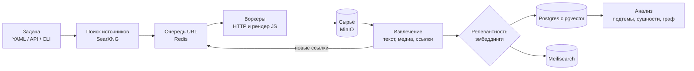

# Universal Harvester

**Пишешь тему, получаешь корпус.** Система сама находит источники по запросу, обходит их, вытаскивает текст и картинки, отсеивает нерелевантное и складывает всё в одно хранилище с полнотекстовым и смысловым поиском.

```bash
harvester run tasks/sol-lemon.yaml    # собирает по теме 477 документов и 727 картинок с 112 доменов
```


---

## Зачем это

Обычный скрейпер пишется под конкретный сайт: селекторы, пагинация, и сломалось при первом редизайне. Мне хотелось обратного: описать **что** собрать, а не **откуда и как**. Задача формулируется как тема с подсказками, а дальше система сама ищет источники, решает, куда идти, и понимает, какие страницы относятся к делу.

Сейчас проект на стадии **Фазы 0**: это рабочий скелет всего конвейера, на котором проверены ключевые архитектурные решения. Он уже собирает реальные корпуса из живого интернета.

## Результат на реальной задаче

Один прогон эталонной задачи `tasks/sol-lemon.yaml`:

| | |
|---|---|
| Документы | **477** (283 с картинками) |
| Картинки | **727** уникальных по содержимому, 174 МБ |
| Домены | **112** |
| Темп | ~81 запрос/мин при вежливой паузе 1.5 с на домен |
| Ошибки | 14% запросов, в основном 403 от антибот-защиты |

Цель фазы была 200 документов и 100 картинок за прогон. Перевыполнено в 2–7 раз.

## Как устроено



1. **Задача** описывается в YAML: тема, подсказки «что имеется в виду» и «что нет», глубина обхода, бюджеты.
2. **Поиск источников** расширяет запрос по шаблонам и находит стартовые страницы через SearXNG.
3. **Воркеры** берут адреса из очереди в Redis с учётом `robots.txt`, пауз на домен, circuit breaker и защиты от SSRF. Для сайтов на JS есть тир с браузерным рендером (crawl4ai).
4. **Сырой ответ сохраняется до разбора** в MinIO, а потом из него достаются структурированные данные (JSON-LD, OpenGraph), основной текст (trafilatura), картинки и ссылки.
5. **Фильтр релевантности** сравнивает эмбеддинг страницы с темой и с «антипримером», чтобы отсечь однофамильцев.
6. **Анализ** делит корпус на подтемы, находит людей и организации и строит граф совместных упоминаний.

## Инженерные решения, которыми я доволен

**Планировщик, который не ждёт.** Узким местом оказалась не сеть, а вежливость: пауза 1.5 с на домен. Восемь воркеров упирались в два-три популярных домена и стояли, темп падал до ~25 запросов в минуту. Теперь воркер берёт из очереди пачку кандидатов, выбирает первый адрес со свободным доменом, а остальные возвращает (`orchestrator/run.py:_claim`). Темп вырос втрое, до ~80 в минуту, без единого лишнего запроса к сайтам.

**Сырьё раньше разбора.** Ответ сайта сохраняется в хранилище до того, как его увидит экстрактор. Поменял логику извлечения — перепарсил архив, не трогая чужие сайты. Эксперименты становятся почти бесплатными.

**Хранилище, адресуемое содержимым.** Файлы лежат в MinIO по sha256, поэтому картинка, перепечатанная на 50 сайтах, хранится один раз. Дубли документов не выбрасываются: их адреса копятся в `source_urls`, и по ним видно, кто кого перепечатал.

**Текст и картинки на равных.** Документы и медиа связаны «многие ко многим», и у обоих есть текстовое представление. Когда добавятся OCR и подписи к изображениям, один запрос будет находить и статьи, и фото.

**Новый источник — плагин, а не форк.** Коннектор — это класс с четырьмя методами (`matches / discover / fetch / extract`) и одна строка регистрации. Ядро не знает ни об одном конкретном сайте.

**Жёсткие бюджеты.** Лимиты страниц, байтов и времени останавливают прогон с записанной причиной, а не тихо сжигают ресурсы.

**Экономия на будущем LLM-извлечении.** Минификатор DOM уже сжимает страницы для промпта на 53–87%.

## Чему научил реальный прогон

- **Многозначность — первая проблема, а не последняя.** По запросу «Sol Lemon» рядом с настоящими находками выдача приносит арт-объект, браслет из яшмы и чистящее средство Pine-Sol Lemon Fresh. Отсюда фильтр релевантности на эмбеддингах и запланированный пробный обход с кластеризацией перед основным.
- **Голый HTTP упирается в антибот.** 14% ошибок — сайты, которым нужен JS или которые блокируют адреса дата-центров. Поэтому появился отдельный тир с браузерным рендером.
- **Профилировать надо до оптимизации.** Интуиция говорила «нужно больше воркеров», а измерения показали, что воркеры просто ждут. Об этом история с планировщиком выше.

## Стек

- **Язык:** Python 3.12, asyncio.
- **API и CLI:** FastAPI, прогресс прогона отдаётся через SSE; командная строка на Typer и Rich.
- **Хранение:** PostgreSQL с pgvector для данных и эмбеддингов, MinIO (S3) для сырых страниц и медиа, Redis для очереди адресов.
- **Поиск:** Meilisearch для полнотекстового поиска, SearXNG для поиска источников.
- **Извлечение:** trafilatura и selectolax для текста, crawl4ai для страниц на JS, Pillow для картинок.
- **Анализ:** fastembed (ONNX) для эмбеддингов, spaCy для поиска сущностей.
- **Инфраструктура и качество:** Docker Compose, pytest, ruff.

## Попробовать

```bash
git clone https://github.com/gro225/universal-scraper && cd universal-scraper
make up                                    # postgres, redis, minio, meilisearch, searxng, api

harvester grab https://example.com/page    # забрать одну страницу
make run TASK=tasks/sol-lemon.yaml         # собрать корпус по теме
harvester search "Sol Lemon"               # искать по собранному
```

После запуска: API и Swagger на http://localhost:8080/docs, MinIO на http://localhost:9001 (`minioadmin` / `minioadmin`), Meilisearch на http://localhost:7700.

Пример задачи:

```yaml
task: sol-lemon
query:
  subject: "Sol Lemon"
  include_hints: ["music", "artist"]       # какой из смыслов нужен
crawl:
  scope: {follow: seed_domain_plus_outlinks, max_depth: 2}
  politeness: {respect_robots: true, delay_per_domain_ms: 1500}
  budget: {max_pages: 2000, max_wall_clock_s: 3600}
extract:
  want: [article_text, images, structured_ld, links]
  media: {download: true, min_width: 200, min_height: 200}
```

Подробности: [USAGE.md](USAGE.md) — запуск, формат задач, CLI и API; [ARCHITECTURE.md](ARCHITECTURE.md) — полная архитектура и дорожная карта.

## Что дальше

- **Фаза 1.** Перцептивные хэши, OCR и CLIP для картинок, поиск почти-дублей по simhash.
- **Фаза 2.** Коннекторы к RSS, Reddit, YouTube и Telegram, LLM-экстрактор, который сам выводит CSS-селекторы, автоматическое снятие многозначности, расписания.
- **Фаза 3.** Таймлайн, аналитический слой на Parquet/Iceberg, дашборды и уведомления о новых находках.

## Этика обхода

Краулер ведёт себя как вежливый гость:

- соблюдает `robots.txt` и держит паузу между запросами к одному домену;
- не обходит авторизацию и платный доступ;
- не ходит во внутреннюю сеть (защита от SSRF);
- честно представляется как `UniversalHarvester`, а не маскируется под браузер, поэтому сайт может узнать бота и закрыть ему доступ правилами для ботов.

Соблюдать условия конкретных сайтов и законы о персональных данных должен тот, кто запускает обход.
